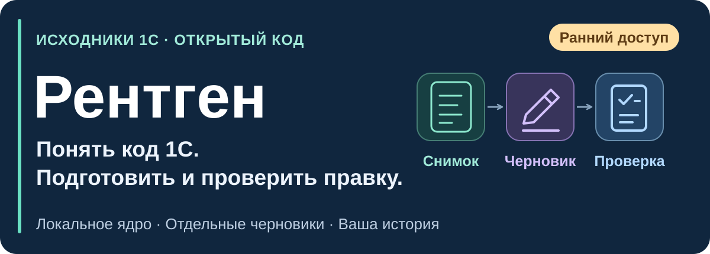
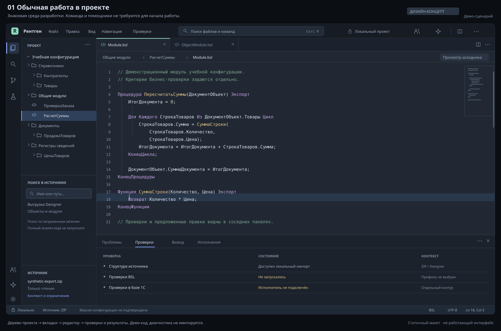
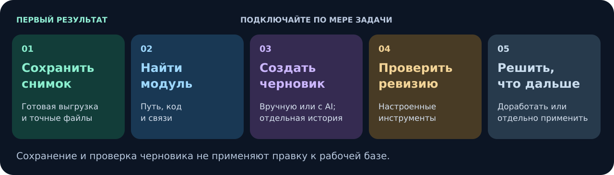

<picture>
  <source media="(max-width: 600px)" srcset="docs/assets/hero-narrow.svg">
  
</picture>

  
   
  Ваша поддержка помогает развивать открытый проект.

  <a href="https://dmitrl-dev.github.io/1cai-public/"><b>Сайт проекта</b></a> ·
  <a href="GETTING_STARTED.md"><b>Попробовать на своём проекте</b></a> ·
  <a href="docs/START_HERE.md">Как это работает</a> ·
  <a href="https://github.com/DmitrL-dev/1cai-public/releases">Скачать</a> ·
  <a href="ROADMAP.md">Куда движемся</a>

# Рентген — от кода 1С к проверяемой правке

Разберитесь в исходниках конфигурации. Подготовьте изменение отдельным
черновиком. Сравните версии и прочитайте результаты проверок перед решением
о применении.

**Первый результат — снимок проекта и список его модулей.** Если папка выгрузки
уже есть, для этого не нужны AI, редактор или установленная платформа 1С.
Работу ведёт локальное ядро; остальные инструменты добавляются по мере задачи.

> **Ранний доступ · MIT · Windows x64 / CPython 3.11**
>
> Опубликованы [Core dev19](https://github.com/DmitrL-dev/1cai-public/releases/tag/core-v0.1.0-dev19)
> и [Companion 0.1.20](https://github.com/DmitrL-dev/1cai-public/releases/tag/companion-v0.1.20).
> Отдельно опубликовано экспериментальное дополнение Linux x86_64.
> Проверены ограниченные сценарии. Полная ежедневная работа, произвольные
> конфигурации и качество AI ещё требуют приёмки.
> [Версии, проверки и ограничения →](docs/product/READINESS.md)

**Текущая цель — полный финальный релиз со всеми запланированными сценариями.**
[Единый план и реестр 127 требований](docs/product/FULL-FINAL-PLAN.md)
сохраняет все 24 IDE-сценария открытыми.
[CI main `413cc65`](docs/product/evidence/development-ci-413cc65-20261016.json)
подтвердил ограниченный Core/Companion workbench в настоящем Windows-редакторе:
обе фазы, восстановление контекста и точные установленные байты прошли проверку.
Это автоматическая приёмка API редактора; human GUI, native 1С и полная IDE открыты.

Следующий совместный блок — [экспериментальный Linux capture и чтение снимков](docs/product/PORTABLE-CORE.md#следующий-блок-linux-capture-и-чтение-снимков).
В исходниках связаны private state, захват источников, доверенный Go scanner,
граф, публикация с квитанцией и CLI/MCP. Его actual Linux и installed-приёмка
ещё не завершены; опубликованный dev19 capture на Linux не содержит.
[Аудит плана выпуска](scripts/release/RELEASE-PLAN-CONTRACT.md) проверяет локальные
bytes и полноту заявленных проверок; готовность финального продукта он не подтверждает.
Лицензированного стенда 1С/EDT пока нет,
поэтому native-проверки остаются открытыми, а реализация и обычный CI продолжаются.

## Экспериментальный Linux GUI: локальный просмотр ZIP

**Экспериментальный маршрут для GNU/Linux x86_64.** Дополнение Core dev19
включает локальный браузерный просмотр Designer XML ZIP, поиск объектов
и модулей, чтение исходников и сравнение архивов. Установка и запуск описаны
в `INSTALL.md` Linux-архива из [выпуска Core dev19](https://github.com/DmitrL-dev/1cai-public/releases/tag/core-v0.1.0-dev19).

- **Выберите ZIP и дождитесь результата.** Передачу и анализ можно отменить;
  после потери ответа интерфейс уточняет исход уже начатого импорта.
- **Найдите объект или модуль.** Поиск метаданных проверяет имена, синонимы,
  канонические типы и пути по всему принятому архиву. Поиск модулей проверяет
  имена и пути; отдельно можно найти модули в папке выбранного объекта.
- **Найдите владельца реквизита.** Непустой поиск объектов также проверяет
  имена и синонимы прямых реквизитов, измерений и ресурсов Designer XML,
  а также реквизитов табличных частей. Результат — объект-владелец с точным
  XML-файлом и первыми 20 совпавшими полями; полный счётчик и границы поиска
  показаны явно. Это ограниченный поиск, не семантический индекс всех метаданных.
- **Просмотрите вхождения в модуле.** В открытом исходнике отдельный буквальный
  поиск показывает полный счётчик, страницы по 200 вхождений и переход к строке
  и колонке. Учитываются пересечения; координаты привязаны к проверенному SHA-256.
  Это текстовые совпадения, не семантические ссылки или вызовы.
- **Сравните выгрузки.** Два ZIP дают список изменений байтов и полный HTML/JSON
  отчёт для ревью. Отдельный трёхсторонний просмотр позволяет явно назначить
  Current, Base и Upstream и увидеть совпадающие и расходящиеся изменения,
  включая удаления. Основа — точный путь, SHA-256 и размер; общее происхождение,
  безопасность слияния и применимость конфигурации не устанавливаются.
- **Откройте проверенные байты.** Свойства XML, исходник UTF-8 и SHA-256 файла
  и архива доступны рядом. Связь модуля с объектом определяется по пути папки.
- **Сравните строки выбранного файла.** В паре ZIP доступны вставки, удаления
  и совпавшие строки с номерами обеих сторон, BOM и окончаниями строк.
  [Ограниченное построчное сравнение](docs/product/LOCAL-GUI.md#построчное-сравнение-выбранного-файла)
  показывает до 200 строк на странице; при превышении лимита выравнивания
  остаются исходные панели. Это текстовое сравнение, без применения правок.

Обработка локальная, без LLM и отправки кода в облако. Исходный ZIP, живая база
и состояние проекта не изменяются. Этот маршрут не создаёт снимок или черновик,
не выполняет диагностику и не подтверждает соответствие исходников живой базе.

Границы: ZIP до 16 МиБ, до 4096 записей и 32 МиБ распакованных данных;
до 200 результатов на странице, просмотр UTF-8 до 256 КиБ на файл.
Остальные объекты, модули и совпадения поиска доступны кнопками предыдущей
и следующей страницы; интерфейс показывает диапазон и общее число результатов.
Windows/macOS для этого GUI ещё не квалифицированы.

**[Запуск, требования и границы локального GUI →](docs/product/LOCAL-GUI.md)**

[Три ZIP: порядок действий, роли и ограничения →](docs/product/LOCAL-GUI.md#инвентарь-трёх-zip-base-current-upstream)

## Следующее поколение Рентгена

**План разработки: привычная IDE для 1С, одного разработчика и команды,
с помощниками или без них.** Код и метаданные в центре, поиск, diff, проверки
и отладка рядом. Дополнительные возможности раскрываются по мере задачи.

**Первые макеты, не снимки работающего приложения.** Новая IDE ещё не входит
в Core dev19 / Companion 0.1.20. [Ревью изменений](site/assets/ide-concept/review.png)
и [необязательный помощник](site/assets/ide-concept/assistant.png) показывают
другие состояния того же будущего рабочего места.

Что планируем и какую пользу хотим получить:

- **Проект, хранилище и поиск.** Понятное подключение и быстрый путь к нужным
  метаданным; полнота и время поиска будут проверяться на известном корпусе.
- **Доверие к отладке.** Явный процесс, версия исходника и подтверждённая
  точка останова вместо догадок о том, какой код сейчас выполняется.
- **Цикл разработки внутри IDE.** Изменить, проверить, обновить dev-базу и
  запустить через штатные инструменты 1С, без возврата в окно Конфигуратора.
- **Команда и AI по необходимости.** Изолированные изменения, review и права
  людей; помощник работает с тем же контекстом и ограничениями.
- **Дальнейшее покрытие.** Формы, запросы, СКД, расширения, объединение,
  сборка, тестирование и deployment после отдельных проверок.

Это цели и исследовательские направления. Сроки, выигрыш в скорости, полное
замещение Конфигуратора/EDT и одинаковые возможности Windows/Linux/macOS
пока не заявлены. AI-архитектуру выбираем сравнением готовых, собственных
и гибридных решений на независимом benchmark.

**[Макеты, 24 сценария, архитектурные направления и критерии готовности →](docs/product/IDE-DEVELOPMENT-PLAN.md)**

## Одна задача. Видимый путь до решения.

<picture>
  <source media="(max-width: 600px)" srcset="docs/assets/product-flow-narrow.svg">
  
</picture>

1. **[Сохраните исходное состояние](GETTING_STARTED.md#3-сохраните-первый-снимок).** Снимок связывает точные файлы и граф проекта.
2. **[Найдите нужный модуль](docs/USER_GUIDE.md#найти-и-прочитать-модуль).** Читайте сохранённую версию, изучайте связи и сравнивайте изменения.
3. **[Подготовьте черновик](GETTING_STARTED.md#5-подготовьте-первый-черновик-и-проверки).** Вручную или с моделью. У предложения своя история и ревизии.
4. **[Проверьте выбранную ревизию](docs/USER_GUIDE.md#проверить-выбранную-версию).** Diff, BSL, компилятор и тесты дают разные результаты и требуют своей настройки.
5. **[Решите, что дальше](docs/USER_GUIDE.md#решить-применять-ли-изменение).** Доработать, оставить в истории или отдельно применить поддержанную правку.

Сохранение черновика и успешная проверка не изменяют рабочую базу.
После правки нужна проверка новой ревизии. Применение к выгрузке и обновление
информационной базы 1С — самостоятельные операции со своими условиями.

## Начните с малого

Для первого запуска подготовьте **Windows x64, CPython 3.11 и копию небольшой
папки выгрузки**. В опубликованный комплект входит scanner; модели в нём нет.

| Шаг | Что сделать | Что получите |
| :--- | :--- | :--- |
| **01 · Установить** | [Скачать Core dev19 и проверить комплект](GETTING_STARTED.md#готовый-core-dev19) | Отдельное окружение ядра |
| **02 · Подключить** | [Зарегистрировать свою папку выгрузки](GETTING_STARTED.md#2-зарегистрируйте-проект) | Проект с локальным состоянием |
| **03 · Увидеть** | [Сохранить снимок и вывести модули](GETTING_STARTED.md#3-сохраните-первый-снимок) | Первый полезный результат |

**[Открыть пошаговый первый запуск →](GETTING_STARTED.md)**
Команды, ожидаемые ответы и [помощь при ошибке](GETTING_STARTED.md#если-что-то-не-получилось)
собраны в одной инструкции.

После этого можно [подключить Companion](GETTING_STARTED.md#4-откройте-модуль-в-редакторе)
для просмотра и черновиков. Для AI, BSL, проверки 1С и YAxUnit есть отдельные
[требования](docs/START_HERE.md#что-подготовить). Они не нужны все сразу.

## Что вы контролируете

| Ваш вопрос | Ответ Рентгена |
| :--- | :--- |
| **Какой код я вижу?** | Выбранный сохранённый снимок, пути и идентификаторы файлов |
| **Что предлагается изменить?** | Отдельный черновик, сравнение и история его версий |
| **Что именно проверено?** | Результат инструмента для конкретной сохранённой ревизии |
| **Что произошло после прерывания?** | Сохранённые квитанции и результаты; неизвестный исход требует разбора |
| **Кто разрешает запись?** | Права проекта, условия выбранной операции и отдельное решение о применении |

Отчёт модели не даёт права на запись. BSL-диагностика, компиляция и тесты
не доказывают всю бизнес-логику. Рентген не заменяет резервные копии базы
и проверку специалистом по 1С.

[Все возможности и их границы →](docs/CAPABILITIES.md)

## Быстрее к результату. Меньше привязок.

Текущий маршрут сохраняем простым; новую IDE развиваем отдельными проверяемыми
срезами. Переносимость и скорость подтверждаем измерениями.

- **Сначала переносимые операции.** Локальное состояние и чтение истории,
  затем безопасное чтение снимков и остальные адаптеры.
- **Редактор и модель по выбору.** Базовый результат не должен ждать сложного
  AI-окружения. Текущий профиль Companion пока требует Windows.
- **Rust по проверяемым частям.** Экспериментальный Linux input core уже
  принимает ограниченные ZIP-выгрузки; время и память измеряются отдельно.
  Универсальное ускорение и полная перепись не заявлены.

**Linux и macOS — цели поэтапной разработки.** Полный продукт на них ещё
не принят. Windows live apply и native-инструменты остаются отдельными
возможностями со своей квалификацией.

[План с критериями завершения](ROADMAP.md) ·
[Поддержка платформ](docs/product/PLATFORM-SUPPORT.md) · [Архитектура](ARCHITECTURE.md) ·
[Linux CLI/state](docs/product/PORTABLE-CORE.md) · [Rust ZIP import](docs/product/RUST-INPUT-CORE.md)

## Выпуск, исходники и эксперименты

| Уровень | Что это значит |
| :--- | :--- |
| **Опубликованная пара** | Core dev19 / Companion 0.1.20. Публичные файлы скачаны и проверены; [квитанция публикации](docs/product/evidence/release-dev19-publication-20261015.json) связывает точные версии, размеры и SHA-256 |
| **Принятые исходники** | Core dev19 собран из [`5eee97e`](https://github.com/DmitrL-dev/1cai-public/tree/5eee97ea050c9f4c06eaceb4d191f16868fb0141). Более поздний checkout не заменяет принятые пакеты; [план и незавершённые направления](docs/product/RELEASE-PLAN-20261015.md), [теги и границы](docs/product/READINESS.md) ведутся отдельно |
| **Эксперимент Linux** | Дополнение Core dev19: локальное состояние/история, ограниченный Rust ZIP import и read-only GUI с поиском и сравнением ZIP. Без capture, live apply, native 1С и Companion; полный продукт на Linux не принят |
| **Следующие этапы** | [Новая IDE и 24 сценария](docs/product/IDE-DEVELOPMENT-PLAN.md), переносимость и оптимизация с отдельной приёмкой по операциям и ОС |
| **Editor / Main witness** | Ограниченные [эксперименты](scripts/verification/main_witness_receiver/README.md); не доказательство готовности ежедневной AI-разработки |

Встроенные README и source-bound инструкции принятых пакетов сохраняют
формулировки момента сборки. Статус публикации и точный способ установки
задают release notes, manifest, `INSTALL.md` Linux-архива и квитанция выше.
Source-facts PR #84 остаётся отдельным draft и не входит в этот выпуск.

Исторические native-проверки относятся к своим версиям и синтетическим
сценариям. Тесты на реальных клиентских базах и полная совместимость типовых
конфигураций ими не подтверждены. [Матрица совместимости →](docs/product/CONFIGURATION-COMPATIBILITY.md)

## Найти нужное

[Первое знакомство](docs/START_HERE.md) ·
[Как пользоваться](docs/USER_GUIDE.md) ·
[Каталог документации](docs/README.md) ·
[Установка из исходников](docs/product/CORE-INSTALLATION.md) ·
[MCP](docs/product/CORE-MCP.md) ·
[Участие в разработке](CONTRIBUTING.md) ·
[Сообщить о проблеме](https://github.com/DmitrL-dev/1cai-public/issues)

Собственный код открыт под [MIT](LICENSE). Обязательной подписки на сервис
Рентгена нет. Лицензии и условия 1С, редактора, моделей и зависимостей действуют
отдельно.

Исторические портал, демо и интеграции

Сохранены в [истории репозитория](https://github.com/DmitrL-dev/1cai-public/tree/c4f633d9edb8a2a15c66358adc2e01835820d947).
Их прежние заявления о готовности не относятся к текущей поставке.

